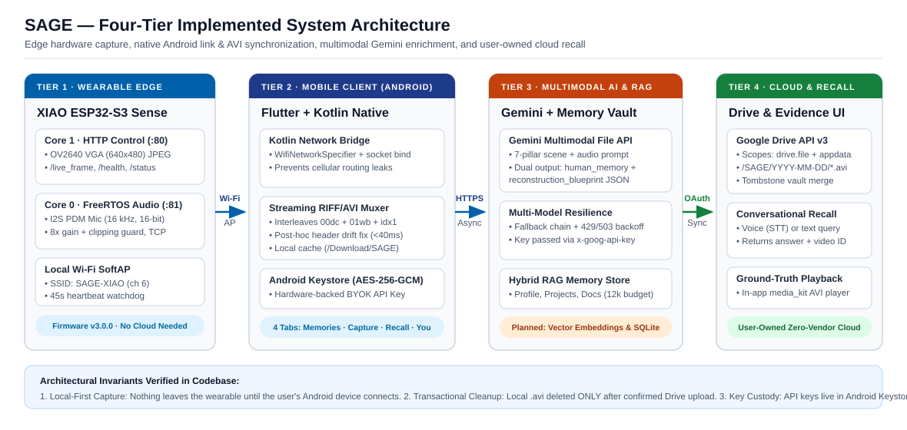
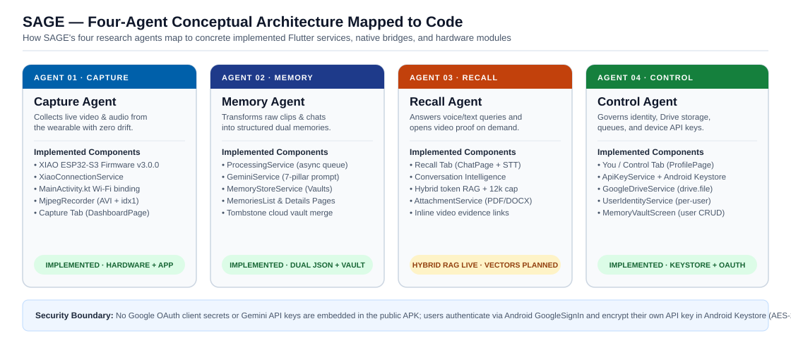
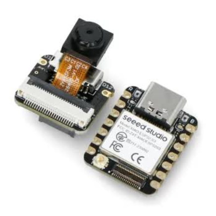

  

  <h1>SAGE — A Multimodal AI Memory System</h1>
  
<strong>Bringing contextual memory to real-world experiences through multimodal AI.</strong>

  

    
    
    
  

  

    
    
    
    
    
  

---

## 30-Second Overview

**SAGE (Smriti Adaptive Guardian Engine)** is an end-to-end wearable multimodal AI memory system. It bridges a compact **Seeed XIAO ESP32-S3 Sense** wearable camera/microphone unit, a **Flutter + Kotlin Android** companion client, **Google Gemini multimodal understanding**, and **user-owned Google Drive archival** so users can capture real-world moments and retrieve exact video evidence using natural-language voice or text questions.

> **Repository Separation:** This repository (`SAGE-Product`) hosts public product documentation, architecture specifications, and verified Android APK releases. Academic methodology and pilot research live in **[ByteBastion/SAGE-AI](https://github.com/ByteBastion/SAGE-AI)**, while proprietary source code is protected in private **`ByteBastion/SAGE-Core`**.

---

## Problem & Solution

### The Problem
Human episodic memory fades rapidly—where keys were placed, what action items were agreed upon in a lecture or meeting, or daily events for individuals experiencing memory loss. Existing lifelogging products force an undesirable trade-off:
- **Always-on cloud wearables** drain tiny batteries, fail without routers/cellular, and lock personal footage inside third-party clouds.
- **Raw recording tools** dump unindexed video files that nobody has time to scrub through.

### The SAGE Solution
1. **Infrastructure-Free Edge Capture:** The wearable hosts its own private Wi-Fi Access Point (`SAGE-XIAO`) with dual-core FreeRTOS task isolation (`HTTP :80` video frames, `TCP :81` I2S audio). No cloud or router is required during capture.
2. **Sub-Perceptual Mobile A/V Sync:** An Android-side streaming RIFF/AVI muxer interleaves variable-FPS MJPEG frames and 16 kHz PCM audio, rewriting container headers post-capture from real audio sample counts to keep drift under `<40 ms` (pilot verified).
3. **Dual-Representation AI Understanding:** Videos are asynchronously analyzed via the Gemini File API using a 7-pillar multimodal prompt producing both a calm **`human_memory`** narrative and an exhaustive **`reconstruction_blueprint`**.
4. **Grounded Conversational Recall:** Users query memories, attachments, and persistent facts by voice or text and immediately jump to the original video clip and transcript as verifiable evidence.

---

## System Architecture

  

### Four-Agent Architecture

  

| Agent | Role | Implemented Subsystems |
| :--- | :--- | :--- |
| **Capture Agent** | Wireless link, live viewfinder, & A/V muxing | XIAO ESP32-S3 Firmware v3.0.0, Kotlin `WifiNetworkSpecifier` + `bindProcessToNetwork()`, `MjpegRecorder` RIFF/AVI muxer, Capture tab. |
| **Memory Agent** | Scene understanding & persistent vaults | Asynchronous `ProcessingService` queue, Gemini File API 7-pillar analysis, `MemoryStoreService` per-user JSON vaults, Memories library & details views. |
| **Recall Agent** | Natural-language & multimodal RAG | Voice (`speech_to_text`) + text Recall Chat, hybrid token-overlap RAG across profile/project/document vaults, and direct video evidence playback. |
| **Control Agent** | Security, cloud custody & device control | Google Drive OAuth (`drive.file` + `appdata`), **Android Keystore (AES-256-GCM)** BYOK Gemini API key settings, queue counters, and Memory Vault CRUD. |

> For end-to-end data flow diagrams and deep technical details, read [System Architecture](docs/system-architecture.md) and [Implementation Overview](docs/implementation-overview.md).

---

## Key Features & Capabilities

- **Router-Free Wearable Link:** Programmatic Android Wi-Fi connection with native `Network.openConnection()` HTTP routing so local requests to `192.168.4.1` never leak to cellular data.
- **Zero-Loss Transactional Backup:** Recorded `.avi` files stay cached locally in `/Download/SAGE` and are deleted **only after** Google Drive confirms upload completion.
- **Multimodal Chat & Document RAG:** Ask questions across recorded memories, persistent profile/project memory, images, PDFs, DOCX files, and code snippets within a 12,000-character context budget.
- **Anti-Hallucination & Multilingual Guardrails:** Unintelligible speech is marked `"unclear"`, non-English speech retains its original language, and answers preserve source evidence links.
- **User-Managed API Key Security:** Public releases embed **zero** API keys. Users store their own Gemini API key directly inside Control Agent using hardware-backed Android Keystore encryption.

---

## Visual Evidence & Hardware

### Genuine Application Identity & Wearable Hardware

| Application Brand & Agents | Seeed XIAO ESP32-S3 Sense Unit |
| :---: | :---: |
|  Capture · Memory · Recall · Control |  OV2640 Camera + Integrated PDM Mic + 8 MB PSRAM |

### Screenshots & Demo Status
- **Real Application Screenshots:** Ready for drop-in at [`assets/screenshots/`](assets/screenshots/README.md) (awaiting final device capture from maintainer).
- **Live Walkthrough Video:** Ready for drop-in at [`assets/demo/`](assets/demo/README.md).
- *Integrity Note:* No synthetic UI mockups or fabricated screenshots are published in this repository.

---

## Technology Stack

| Layer | Technologies |
| :--- | :--- |
| **Wearable Edge** | Seeed Studio XIAO ESP32-S3 Sense, C++ (Arduino/PlatformIO), FreeRTOS dual-core tasks, OV2640 JPEG DMA, I2S PDM audio |
| **Mobile Client** | Flutter 3 / Dart 3, Provider + `ValueNotifier`, `media_kit` + `video_player`, `speech_to_text`, custom journal design system |
| **Android Native** | Kotlin `MethodChannel` & `EventChannel`, `WifiNetworkSpecifier`, `ConnectivityManager.bindProcessToNetwork()`, `AndroidKeyStore` (AES-256-GCM) |
| **AI & Retrieval** | Google Gemini File API & `generateContent` JSON mode, multi-model fallback with 429/503 backoff, Hybrid token-overlap RAG |
| **Cloud Storage** | Google Drive API v3 (`drive.file` + `drive.appdata`), Google Sign-In OAuth 2.0, tombstone-aware cross-device vault merge |

---

## Android Installation & Quick Start

> **Important for Evaluators:** You **do not** need the ESP32-S3 hardware to test the Android application. Recall Chat, Persistent Memory Vault, Document/Image Analysis, and Google Drive synchronization work independently on any Android device.

1. Download **`SAGE-v1.0.0-android.apk`** from the [v1.0.0 Release Page](https://github.com/ByteBastion/SAGE-Product/releases/tag/v1.0.0).
2. Enable **Install from unknown sources** on Android and install the APK.
3. Open SAGE → navigate to **Control Agent (`You` tab)** → **AI & Intelligence → Gemini API Key**.
4. Paste your personal [Google AI Studio Gemini API Key](https://aistudio.google.com/apikey) and tap **Save & Verify Key** (encrypted locally in Android Keystore; persists across app restarts).
5. *(Optional)* Connect your Google Drive account under **Storage & Backup** to enable cloud backup and cross-device Memory Vault sync.

Full step-by-step instructions: [Android Installation Guide](docs/android-installation.md) · [Hardware Setup Guide](docs/hardware-setup.md)

---

## Current Implementation Status

| Capability | Status | Evidence / Notes |
| :--- | :---: | :--- |
| Dual-core ESP32-S3 capture firmware (`v3.0.0`) | **Implemented** | HTTP `:80` control/viewfinder + TCP `:81` 16 kHz I2S audio; 45s watchdog |
| Android native Wi-Fi binding & streaming AVI muxer | **Implemented** | `WifiNetworkSpecifier` + `bindProcessToNetwork()` + post-hoc `idx1`/header calibration |
| 7-Pillar Gemini video enrichment & dual JSON output | **Implemented** | File API upload, polling, JSON mode, fallback chain, `human_memory` + blueprint |
| Hybrid RAG over Profile, Projects, Docs & Chat | **Partially Implemented** | Token-overlap ranking + 12k context cap live; **vector embeddings are Planned** |
| Control Agent Keystore API Key Manager | **Implemented** | AES-256-GCM encryption via Android Keystore; persists across restarts; no key logging |
| Automated unit & Gemini integration tests | **Partially Implemented** | 26 passing unit/integration tests; full physical hardware E2E requires device-in-loop |
| FastAPI OAuth backend proxy | **Experimental** | Prototyped early; current mobile release uses Google Sign-In + on-device Keystore |
| Local DB encryption, face-blur, iOS Wi-Fi validation | **Planned** | Documented transparently in [Known Limitations](docs/known-limitations.md) |

---

## Documentation Index

- [Product Overview](docs/product-overview.md)
- [System Architecture](docs/system-architecture.md)
- [Implementation Overview](docs/implementation-overview.md)
- [Android Installation Guide](docs/android-installation.md)
- [Hardware Setup Guide](docs/hardware-setup.md)
- [Engineering Decisions](docs/engineering-decisions.md)
- [Known Limitations](docs/known-limitations.md)
- [Privacy & Security](docs/privacy-and-security.md) · [PRIVACY.md](PRIVACY.md) · [SECURITY.md](SECURITY.md)
- [Changelog](CHANGELOG.md) · [Releases](releases/README.md) · [Contributing](CONTRIBUTING.md)

---

## Research & License

- **Academic Foundation:** [ByteBastion/SAGE-AI](https://github.com/ByteBastion/SAGE-AI) — contains the literature review, gap analysis, synchronization methodology, and pilot evaluation metrics (`85%` query recall across 20 pilot queries, `<40 ms` A/V drift, `0/20` spurious disconnects).
- **License:** Copyright © 2026 Vinayak Sharma / ByteBastion. See [LICENSE](LICENSE).

