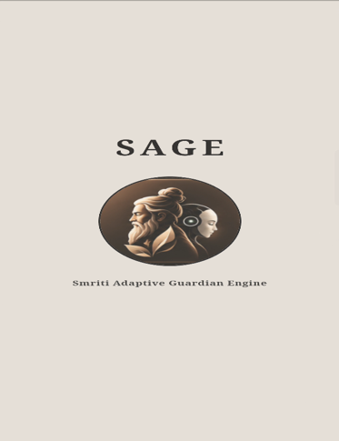
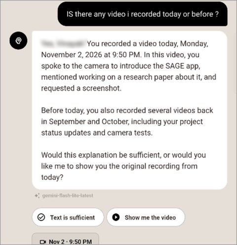

# Application Screenshots

Authentic screen captures taken directly from the compiled Android application (`com.sage.sage.core`):

| # | Screen / Agent | Screenshot | Key Functionality Shown |
| :---: | :--- | :---: | :--- |
| **1** | **Launch Screen** (`01-splash-launch.png`) |  | **SAGE — Smriti Adaptive Guardian Engine** startup screen and local per-user vault loading. |
| **2** | **Capture Agent** (`03-capture-dashboard.png`) |  | Live XIAO ESP32-S3 viewfinder stream with FPS & latency telemetry (`LIVE`, `5fps · 346ms`) and recording control. |
| **3** | **Memory Details** (`02-memory-details.png`) |  | Gemini-generated scene narrative paired with timestamped audio/speaker original evidence (`00:01–00:04`). |
| **4** | **Recall Agent** (`04-recall-chat.png`) |  | Natural-language memory query with grounded explanation, `Text is sufficient` / `Show me the video` actions, and evidence clip chip. |
| **5** | **Control Agent** (`05-control-agent.png`) |  | Google Drive sync summary (`Uploaded` / `Pending` counts) and live asynchronous Gemini analysis queue progress. |
| **6** | **Memory Vault** (`06-memory-vault.png`) |  | Verified and inferred identity/context facts with full edit, delete, and status filtering controls (`All`, `Verified`, `Inferred`, `Active`, `Archived`). |

*Note: All screenshots are genuine device captures with sensitive user details blurred where appropriate.*
