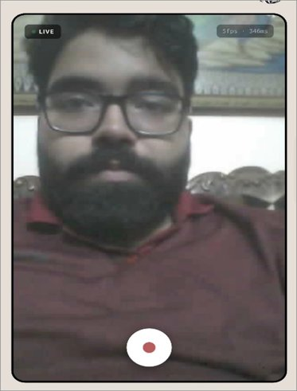
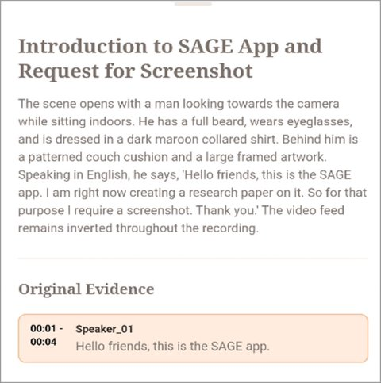
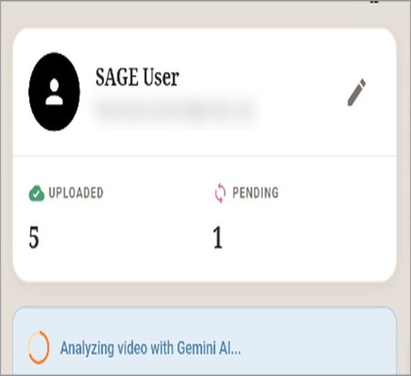
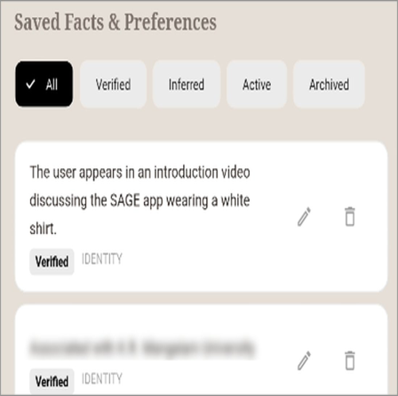

# Application Screenshots

Authentic screen captures taken directly from the compiled Android application (`com.sage.sage.core`):

| Launch & Brand Identity | Live Wearable Capture | Memory Analysis & Evidence |
| :---: | :---: | :---: |
|  **1. Launch Screen (`01-splash-launch.png`)** SAGE — Smriti Adaptive Guardian Engine startup experience. |  **2. Capture Agent (`03-capture-dashboard.png`)** Live XIAO ESP32-S3 viewfinder stream with FPS & latency telemetry (`LIVE`, `5fps · 346ms`) and recording control. |  **3. Memory Details (`02-memory-details.png`)** Gemini-generated scene narrative paired with timestamped audio/speaker original evidence (`00:01–00:04`). |

| Conversational Recall & Video Jump | Control Agent & Processing Queue | Personal Memory Vault |
| :---: | :---: | :---: |
|  **4. Recall Agent (`04-recall-chat.png`)** Natural-language memory query with grounded explanation, `Text is sufficient` / `Show me the video` actions, and evidence clip chip. |  **5. Control Agent (`05-control-agent.png`)** Google Drive sync summary (`Uploaded` / `Pending` counts) and live asynchronous Gemini analysis queue progress. |  **6. Memory Vault (`06-memory-vault.png`)** Verified and inferred identity/context facts with full edit, delete, and status filtering controls. |

*Note: All screenshots are genuine device captures with sensitive user details blurred where appropriate.*
