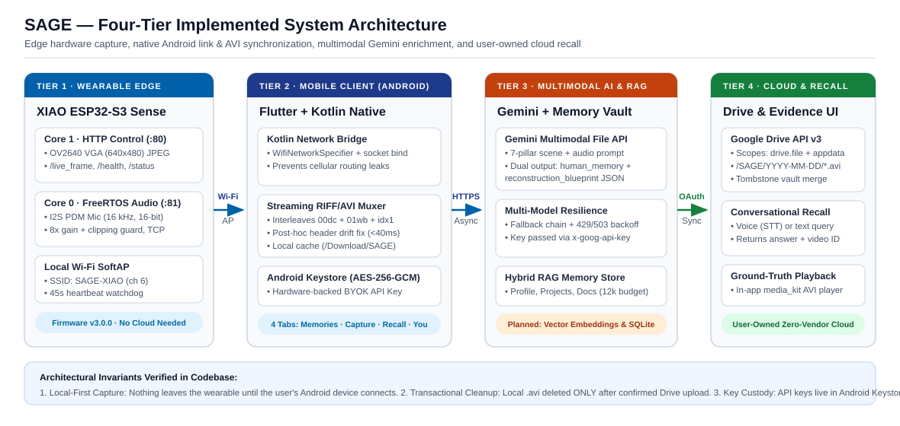
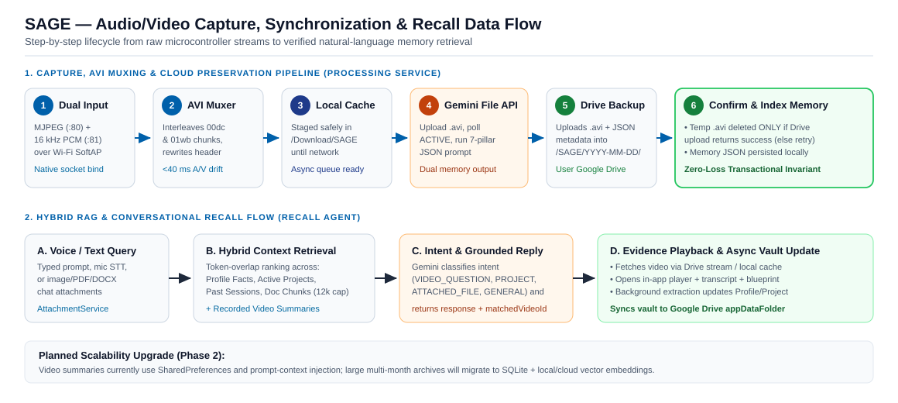

# System Architecture — SAGE

<div align="center">
  
</div>

---

## End-to-End Data Flow

<div align="center">
  
</div>

```
Audio/Video Input (ESP32-S3 OV2640 + PDM Mic)
        │  Wi-Fi SoftAP "SAGE-XIAO" (HTTP :80 + TCP :81)
        ▼
Capture Layer (Kotlin Network Binding + MjpegRecorder AVI Muxer)
        │  Local Cache (/storage/emulated/0/Download/SAGE/*.avi)
        ▼
Processing & Understanding (ProcessingService -> Gemini File API 7-Pillar Prompt)
        │  Produces Dual Memory JSON (human_memory + reconstruction_blueprint)
        ▼
Memory Management (MemoryStoreService Per-User Vault + SharedPreferences Index)
        │  Transactional Google Drive Upload (delete local .avi ONLY on success)
        ▼
Contextual Storage / Retrieval (Hybrid Token-Overlap RAG + Video Summary Injection)
        │  Multi-Model Fallback + Intent Classification
        ▼
Response Generation & Flutter Application (Recall Chat + In-App Video Evidence Player)
```

---

## Detailed Tier & Agent Breakdown

### 1. Capture Agent (`Firmware v3.0.0` + `MainActivity.kt` + `MjpegRecorder`)
- **Hardware Concurrency:** Core 1 serves HTTP requests (`/health`, `/status`, `/live_frame`) directly from PSRAM camera DMA buffers; Core 0 runs a dedicated FreeRTOS task reading `16 kHz`, 16-bit mono PCM audio from the PDM microphone (`GPIO 41/42`) and writing over TCP port `81` (`TCP_NODELAY`).
- **Android Network Binding:** Because Android routes traffic away from Wi-Fi networks that lack internet connectivity, the native Kotlin bridge pairs `WifiNetworkSpecifier` with `ConnectivityManager.bindProcessToNetwork()` and routes local requests through `Network.openConnection()`.
- **Post-Hoc AVI Sync:** Because the OV2640 sensor frame rate varies with lighting while I2S audio runs at a constant 16,000 Hz, `MjpegRecorder` writes interleaved `00dc`/`01wb` chunks, appends an `idx1` index for ExoPlayer/libmpv compatibility, and patches the 1024-byte RIFF header at recording stop using `videoRate = frameCount * 16000` and `videoScale = totalAudioSamples`.

### 2. Memory Agent (`ProcessingService` + `GeminiService` + `MemoryStoreService`)
- **Deferred Asynchronous Pipeline:** Recordings never block on connectivity. Once internet is available, `ProcessingService` uploads pending `.avi` clips via the Gemini File API, polls until `ACTIVE`, and generates structured JSON under a 7-pillar multimodal prompt:
  1. Audio Understanding
  2. Visual Scene Understanding
  3. Off-Camera Events
  4. Persistent Video Memory
  5. Audio-Visual Fusion
  6. Temporal Accuracy
  7. Structured Chronological Description
- **Dual-Representation JSON:** Every recording yields both `human_memory` (warm chronological prose) and `reconstruction_blueprint` (timestamped entities, objects, spatial relations, transcript, OCR, and evidence claims).

### 3. Recall Agent (`ChatPage` + `AttachmentService` + Hybrid RAG)
- **Context Retrieval (`retrieveRelevantContext`):** Scores and retrieves relevant entries across four memory tiers within a **12,000-character context budget**:
  - Personal Profile Facts (verified vs. inferred provenance guardrails)
  - Active Project States
  - Past Session Summaries
  - Chunked Document Memories (PDF stream extraction, DOCX XML extraction, text/code files) + inline images/PDFs under 12 MB
- **Intent-Driven Grounding:** Classifies each prompt into intents (`VIDEO_QUESTION`, `VIDEO_DISPLAY_REQUEST`, `TEXT_SUFFICIENT_CONFIRMATION`, `PROJECT_QUERY`, `PERSONAL_IDENTITY_QUERY`, `ATTACHED_FILE_ANALYSIS`, `GENERAL_QUESTION`, etc.) and links directly to the matched `videoId` so the user can watch the source recording as proof.

### 4. Control Agent (`ProfilePage` + `ApiKeyService` + `GoogleDriveService`)
- **API Key Custody:** Encrypts user-supplied Gemini API keys using Android Keystore (`AES-256-GCM`), passes keys via `x-goog-api-key` headers, and redacts keys from error diagnostics.
- **Google Drive Sync:** Uses `drive.file` (for `/SAGE/YYYY-MM-DD/*.avi` + JSON metadata) and `drive.appdata` (for tombstone-reconciled `sage_vault_<userId>.json` cross-device synchronization).

---

## Implemented vs. Proposed Components

| Component | Status | Proposed / Roadmap Upgrade |
| :--- | :---: | :--- |
| Dual-core wearable streaming & native network binding | **Implemented** | iOS `NEHotspotConfiguration` validation |
| Streaming RIFF/AVI muxer with post-hoc A/V sync | **Implemented** | Hardware enclosure & sleep duty-cycling |
| Gemini File API 7-pillar JSON pipeline & model fallback | **Implemented** | Thin backend API proxy + confidence scoring |
| Hybrid token-overlap RAG & Drive AppData vault sync | **Partially Implemented** | SQLite migration + vector embeddings (online & offline) |
| Encrypted Android Keystore API key management | **Implemented** | Local database encryption (SQLCipher) + bystander face-blur |

